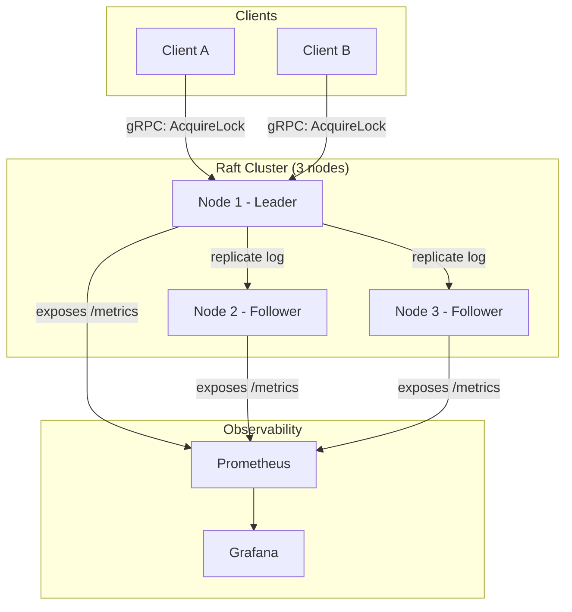

# QuorumLock — A Distributed Lock Service Built on Raft

A small, correctness-focused distributed lock service in Python, built on top of a proven Raft consensus library (`pysyncobj`). Clients acquire mutually-exclusive locks on named resources; locks are lease-based (auto-expire if a client crashes) and every grant comes with a monotonically increasing **fencing token** so stale clients can never corrupt downstream systems — even during leader failover.

This project exists to demonstrate real distributed-systems fundamentals: consensus, leader election, lease semantics, and the "zombie client" correctness problem that most naive lock implementations get wrong.

---

## Why this project

Most "distributed lock" tutorials skip the hard part: what happens when a client thinks it holds the lock, but it's actually been evicted (GC pause, network partition, clock drift) and a second client has since acquired it? Without **fencing tokens**, both clients can act as if they hold the lock — silent data corruption. QuorumLock implements the correct pattern end-to-end and proves it with fault-injection tests (killing the leader mid-operation, partitioning nodes, etc.).

---

## Architecture



**Request flow:** a client calls `AcquireLock` on any node. If that node isn't the current Raft leader, it redirects the client to the leader. The leader appends a log entry (`lock granted: resource=X, holder=client_id, token=N, expires_at=T`), replicates it to a majority of nodes, and only then responds to the client with the lock + fencing token. A background goroutine-equivalent (asyncio task) expires locks whose lease has lapsed without renewal.

---

## Core concepts

- **Raft consensus** — handled by `pysyncobj`, a mature Python Raft implementation. Provides leader election and log replication so the cluster stays correct even if a minority of nodes fail.
- **Lease-based locks** — every lock has a TTL. Clients must renew before it expires, or it's automatically released. This prevents a crashed client from blocking a resource forever.
- **Fencing tokens** — every successful `AcquireLock` returns a strictly increasing integer token. Downstream systems (e.g. a storage backend) should reject any write that arrives with an older token than one they've already seen — this is what actually prevents split-brain corruption, not just holding the "lock" itself.
- **Leader redirection** — clients can talk to any node; non-leader nodes respond with the current leader's address so clients converge automatically.

---

## Tech stack

| Layer | Choice | Why |
|---|---|---|
| Language | Python 3.11+ | Focus effort on lock semantics, not consensus implementation |
| Consensus | `pysyncobj` | Working Raft implementation — avoids reinventing a notoriously bug-prone algorithm |
| RPC | gRPC (`grpcio`) | Type-safe client/server contracts, industry-standard for this category of service |
| Durable storage (optional) | SQLite | Snapshotting cluster state across restarts |
| Metrics | `prometheus_client` | Exposes lock latency, leader status, failover events |
| Dashboards | Grafana | Visualize cluster health and lock activity |
| Deployment | Docker Compose | Spin up a 3–5 node cluster locally, kill/restart nodes to demo failover |
| Testing | `pytest` + custom fault-injection scripts | Prove correctness under node failure, not just claim it |

---

## Repository structure

```
quorumlock/
├── server/
│   ├── raft_node.py        # pysyncobj wrapper, cluster bootstrap
│   ├── lock_manager.py     # lease + fencing token logic (the core of the project)
│   ├── grpc_service.py     # gRPC server implementation
│   └── metrics.py          # Prometheus metric definitions
├── proto/
│   └── lock_service.proto  # gRPC service + message definitions
├── client/
│   └── quorumlock_client.py  # Python client SDK
├── demo/
│   └── checkout_service.py # Example app using QuorumLock to prevent double-processing an order
├── tests/
│   ├── test_lock_manager.py
│   └── fault_injection/
│       ├── kill_leader.py
│       └── network_partition.py
├── deploy/
│   ├── docker-compose.yml
│   ├── prometheus.yml
│   └── grafana/
│       └── dashboards/lock_cluster.json
├── docs/
│   └── benchmarks.md       # Failover time, throughput, acquisition latency results
├── GIT_WORKFLOW.md
└── README.md
```

---

## API design (gRPC)

```protobuf
service LockService {
  rpc AcquireLock (AcquireRequest) returns (AcquireResponse);
  rpc RenewLock   (RenewRequest)   returns (RenewResponse);
  rpc ReleaseLock (ReleaseRequest) returns (ReleaseResponse);
  rpc GetLockStatus (StatusRequest) returns (StatusResponse);
}

message AcquireRequest {
  string resource_id = 1;
  string client_id = 2;
  int32 ttl_seconds = 3;
}

message AcquireResponse {
  bool granted = 1;
  int64 fencing_token = 2;
  string leader_hint = 3; // set if this node isn't the leader
}
```

---

## Build roadmap

Each phase below maps to its own git branch — see `GIT_WORKFLOW.md` for the exact commands.

| Phase | Branch | Deliverable |
|---|---|---|
| 1 | `feature/single-node-server` | Single-node lock server, gRPC API, no replication yet |
| 2 | `feature/raft-cluster` | 3-node Raft cluster via `pysyncobj`; writes replicate correctly |
| 3 | `feature/fencing-tokens` | Lease TTLs + monotonic fencing tokens implemented |
| 4 | `feature/docker-demo` | Docker Compose cluster; manual failover demo works |
| 5 | `feature/observability` | Prometheus metrics + Grafana dashboard |
| 6 | `feature/fault-injection` | Automated fault-injection test suite + demo checkout app |
| 7 | `feature/docs-and-benchmarks` | Final README polish, architecture diagram, benchmark numbers |

---

## Fault-injection test plan

- Kill the current leader mid-request → verify a new leader is elected and the client transparently retries.
- Partition a minority of nodes from the majority → verify the majority side keeps operating correctly and the minority refuses writes.
- Simulate a "zombie client" (holds an expired lease, tries to act anyway) → verify its fencing token is correctly rejected by a downstream consumer.
- Kill and restart a node → verify it catches up via log replication without manual intervention.

## Benchmarks to capture (for the README's results section)

- Lock acquisition latency (p50/p99) under normal operation
- Failover time: how long from leader death to a new leader serving requests
- Throughput: acquisitions/sec sustained by the cluster
- Correctness: 0 instances of two clients holding the same lock simultaneously across N fault-injection runs

---

## Setup (once code is added)

```bash
docker compose -f deploy/docker-compose.yml up --build
python client/demo_client.py
```

---

## Resume bullet (draft, update numbers once benchmarks are in)

> Architected a Raft-based distributed lock service in Python with lease-based expiry and fencing tokens, achieving correct failover in under Xs across N fault-injection scenarios; instrumented with Prometheus/Grafana for real-time cluster observability.
